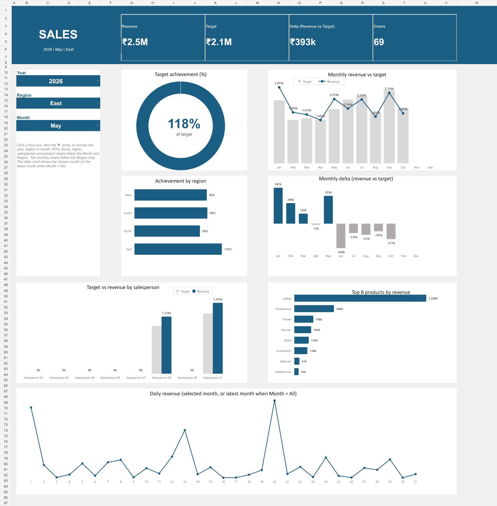

# Sales Performance & Target MIS

An Excel dashboard for comparing sales revenue with monthly targets across regions, products, and salespeople.

## Dashboard

Use the blue dropdowns to choose year, region, and month. The KPI cards, achievement gauge, region chart, salesperson chart, and product chart follow the month and region filters. The monthly charts follow the region filter. The daily chart shows the selected month, or the latest month when Month is set to All.

The dashboard includes four KPI cards and seven charts:

- KPI cards: revenue, target, revenue delta, and sales record count
- Target achievement percentage
- Monthly revenue compared with target
- Monthly revenue delta
- Achievement by region
- Revenue and target by salesperson
- Top eight products by revenue
- Daily revenue for the selected month, or the latest month when Month is set to All

## Workbook tabs

| Tab | Contents |
| --- | --- |
| Dashboard | Filterable KPI cards and charts |
| Sales Detail | 3,000 sales records with date, salesperson, region, product, quantity, and amount |
| Target Detail | 80 monthly target and actual records |
| Product Summary | Revenue and units by product |
| Monthly Trend | Monthly revenue and order totals |
| Daily Summary | Daily revenue, orders, and units |
| Monthly Performance | Monthly revenue, target, delta, and achievement summary |
| Reference Data | Month, salesperson, and region lookup lists |
| Helper Tables | Supporting calculations used by the dashboard charts |

## Metrics and data

- **Revenue:** sum of sales amounts.
- **Target:** sum of target amounts.
- **Delta:** revenue minus target.
- **Achievement:** revenue divided by target.
- **Orders:** count of matching sales detail rows in the selected range.

The workbook uses rupee formatting. The sales records cover January 1 through October 30, 2026. Salesperson names are anonymized as `Salesperson 01` through `Salesperson 08`; the sales and target figures are unchanged.

## Files

- [Excel workbook](projectbook1_completed.xlsx)
- [Dashboard preview](dashboard_preview.png)
